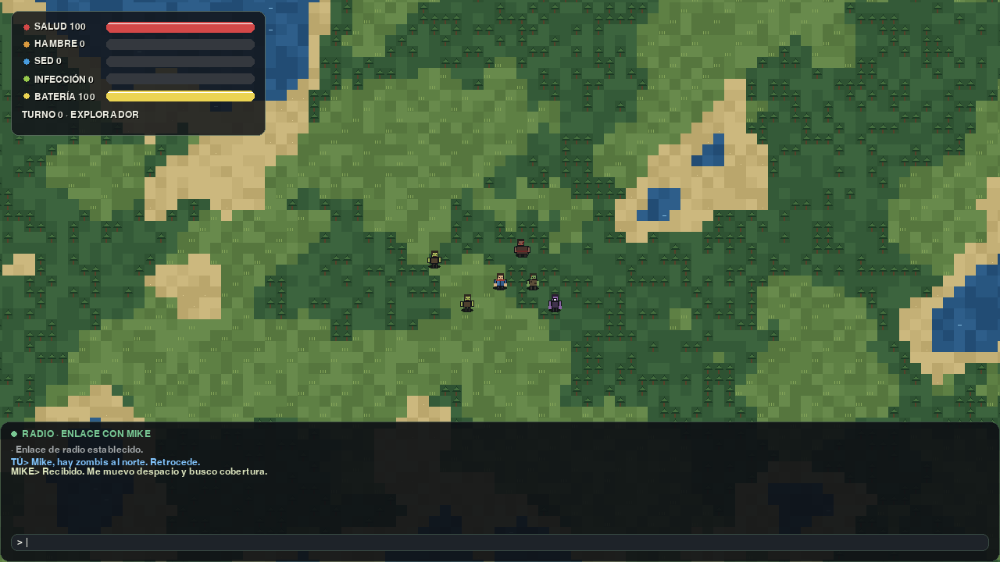
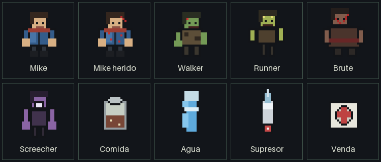
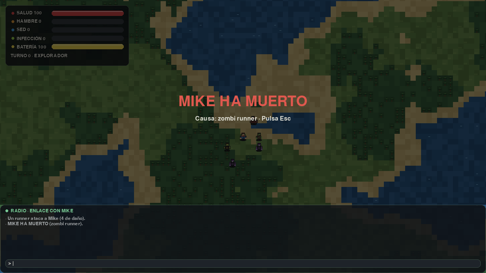

# MIKE: SEÑAL DE SUPERVIVENCIA

Survival roguelite 2D en pixel art con mundo abierto procedural. El
jugador **no** controla a Mike: es el Operador, que lo coordina por radio
con batería limitada. Mike es un agente autónomo que corre sobre la API
de DeepSeek (`deepseek-flash`) con function calling.

📖 **[Guía de usuario completa](docs/GUIA_USUARIO.md)** — historia,
controles, HUD, estrategia, configuración y solución de problemas.



## Capturas

| Mundo y HUD | Sprites |
| --- | --- |
|  |  |



## Estado

**Proyecto completo — 9/9 fases.**

- mundo por chunks con dos capas de Perlin y persistencia SQLite;
- Mike con salud, hambre, sed, infección, batería, inventario y rasgos;
- HUD, chat de radio con typewriter y agente DeepSeek con 10 tools;
- 4 subtipos de zombi, combate, eventos narrativos y game over;
- sprites procedurales cacheados y SFX generados con pyfxr;
- terreno con variación de color, árboles, rocas y detalles procedurales;
- HUD translúcido, chat redondeado y sprites de 24 px con sombras;
- Docker, compose y Makefile;
- meta-progresión: memorias entre runs y rasgo veterano tras 10 muertes.

Cada run recibe un rasgo aleatorio (`neutral`, `resiliente` o `explorador`,
más `veterano` cuando se desbloquea). Al morir, Mike deja un recuerdo
global que aparece en el prompt de las siguientes runs. Las estadísticas
persisten en `stats` y la meta-progresión en `meta_progression`.

Mike tiene **instinto propio**: come, bebe, se cura, combate, rebusca y
avanza hacia el Refugio 7 sin gastar tokens. DeepSeek solo se consulta
cuando el Operador escribe; cada mensaje limita a 2 rondas de tools,
180 tokens de salida y 4 mensajes de historial.

## Cómo jugar

### Windows: un solo comando

Haz doble clic en `run_windows.cmd` o ejecuta:

```bat
run_windows.cmd
```

El script comprueba Python 3.12, crea `.venv`, instala dependencias y
arranca el juego. Solo necesitas Python 3.12 instalado; si no lo tienes:
`winget install -e --id Python.Python.3.12`. En Windows se usa un Perlin
puro incluido en el repo porque el paquete `noise` requiere compilador C.

### Linux / macOS

```bash
python3.12 -m venv .venv
source .venv/bin/activate
pip install -r requirements.txt
cp .env.example .env             # rellena DEEPSEEK_API_KEY
python main.py
```

Se abre una ventana de 1280×720. Escribe en la barra inferior y pulsa
`Enter` para hablar con Mike; `Esc` o cerrar la ventana termina la
partida. Cada mensaje consume 1–3% de batería de radio. Sin API key el
juego arranca y muestra «Radio sin enlace».

## Docker

En Linux con servidor X11:

```bash
cp .env.example .env
xhost +local:docker
docker compose up --build
```

El volumen `./data` conserva la base de datos SQLite entre ejecuciones.
En Windows/macOS se recomienda ejecutar el juego de forma nativa o usar
un servidor X11 con `DISPLAY` configurado.

## Calidad

```bash
make test          # pytest
make lint          # ruff + black --check
make docker-build  # construye la imagen
make docker-test   # tests dentro del contenedor
```

## Estructura

`db/` persistencia SQLite, `game/` simulación, `agent/` cliente DeepSeek y
herramientas, `ui/` HUD y chat, `assets/` sprites y audio procedural,
`docs/` guía de usuario y capturas, `tests/` suite de pytest.

## Hoja de ruta

1. ✅ Esqueleto, BD y repositorios
2. ✅ Mundo procedural con chunks y Perlin
3. ✅ Mike, HUD y estado
4. ✅ Cliente DeepSeek con function calling
5. ✅ Chat bidireccional
6. ✅ Zombis, combate y eventos
7. ✅ Assets y audio procedurales
8. ✅ Docker y distribución
9. ✅ Persistencia y meta-progresión

## Licencia

MIT. Ver [LICENSE](LICENSE).
