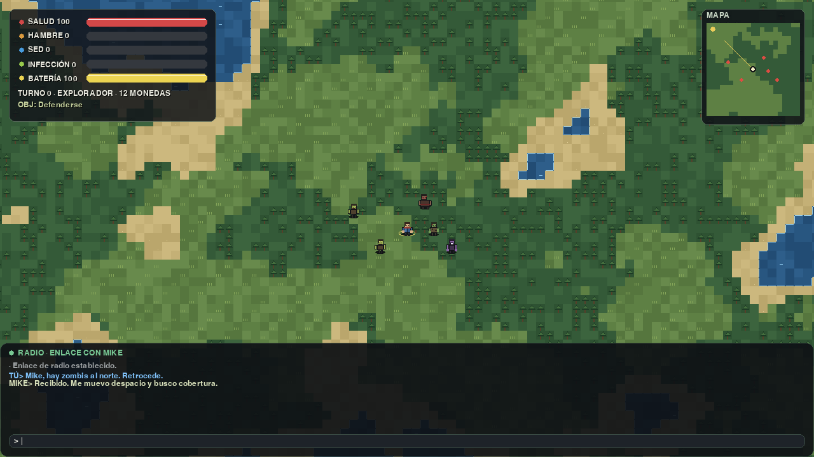
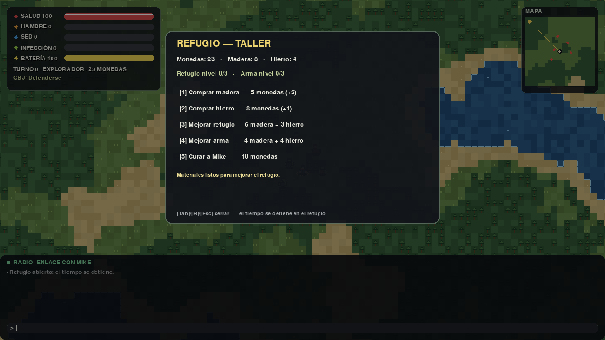
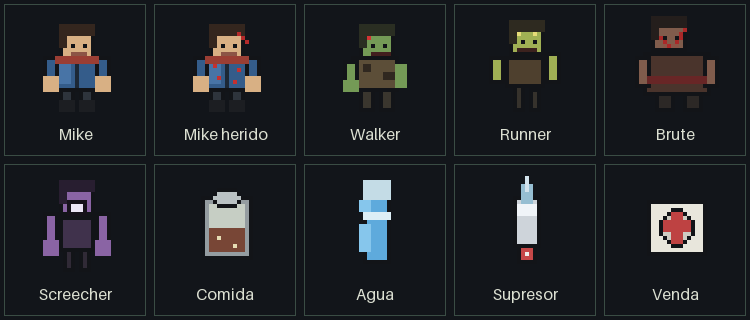
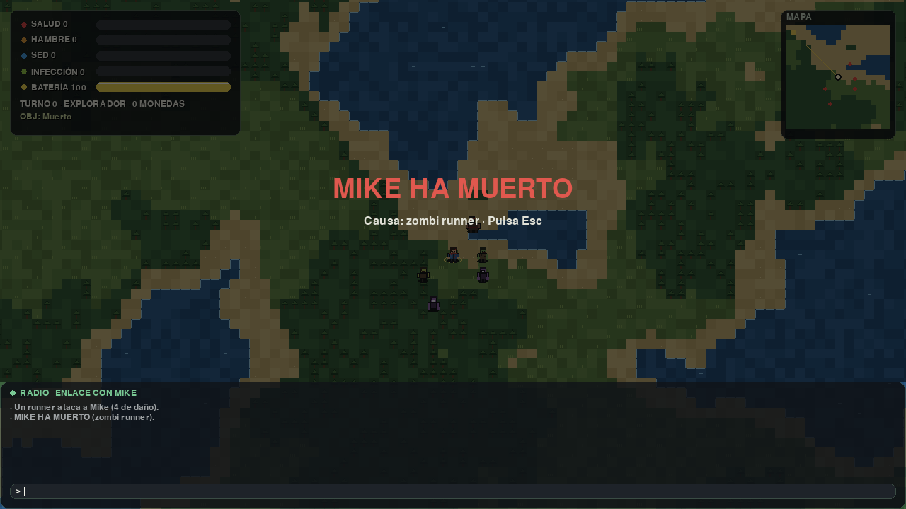

# Guía de usuario — MIKE: SEÑAL DE SUPERVIVENCIA



## De qué va el juego

Una ciudad post-apocalíptica. **Mike** es un paramédico de 34 años que fue
mordido por un infectado y resultó inmune. La infección no desaparece:
avanza por oleadas y, si llega al 100, pierde el control durante unos
segundos. Su hija **Elena**, de 12 años, fue evacuada al **Refugio 7** hace
tres meses. Mike quiere llegar hasta ella.

Tú no manejas a Mike con el teclado. Tú eres el **Operador**: un
superviviente con acceso a cámaras y mapas que Mike no puede ver. Hablas
con él por radio. La batería de esa radio es limitada y cada mensaje
cuesta entre 1 % y 3 %.

Mike tiene instinto propio: come, bebe, se cura, combate, rebusca y
avanza hacia el Refugio 7 sin gastar tokens. Tú intervienes para darle
dirección, contexto o ayuda cuando la situación lo merece.

## Lo que necesitas

- **Windows:** Python 3.12 o `uv` (el lanzador instala Python si hace
  falta).
- **Linux/macOS:** Python 3.12.
- **Opcional:** una `DEEPSEEK_API_KEY` para el chat con Mike. Sin clave,
  el juego arranca y avisa de que la radio no tiene enlace.
- **Docker:** solo si quieres ejecutarlo en contenedor (Linux con X11).

## Instalación rápida

### Windows: un solo comando

```bat
run_windows.cmd
```

También puedes hacer doble clic sobre `run_windows.cmd`. El lanzador:

1. Busca Python 3.12 (o lo instala con `uv` si está disponible).
2. Crea `.venv`.
3. Instala las dependencias.
4. Copia `.env.example` a `.env` la primera vez.
5. Arranca el juego.

Si no tienes Python 3.12:

```bat
winget install -e --id Python.Python.3.12
```

### Linux / macOS

```bash
python3.12 -m venv .venv
source .venv/bin/activate
pip install -r requirements.txt
cp .env.example .env
python main.py
```

Windows no compila la librería `noise` porque no tiene wheel: el juego usa
un Perlin puro incluido en el repo. Linux/Docker usan la implementación C.

### Docker

En Linux con servidor X11:

```bash
cp .env.example .env
xhost +local:docker
docker compose up --build
```

La base de datos se guarda en `./data`.

## Cómo se juega

1. Se abre una ventana de 1280×720 con el mundo, el HUD y el chat.
2. Mike avanza y actúa solo cada pocos segundos; su objetivo actual
   aparece en el HUD (`OBJ`).
3. Escribe en la barra inferior y pulsa **Enter** para hablar con él.
4. Mike responde por radio y, si hace falta, usa herramientas para moverse,
   escanear, comer, beber, curarse, atacar o recordar algo.
5. Pulsa **Tab** para abrir el refugio, comprar recursos y mejorar.
6. La partida termina si Mike muere. La siguiente run conserva recuerdos,
   estadísticas, desbloqueos y mejoras del refugio.

### Controles

| Tecla | Acción |
| --- | --- |
| Cualquier letra/número | Escribir en la radio |
| `Enter` | Enviar mensaje al Operador |
| `Backspace` | Borrar carácter |
| `Tab` | Abrir/cerrar el refugio y taller |
| `Esc` | Salir del juego (o cerrar el refugio) |
| Cerrar ventana | Salir del juego |

### La radio y los tokens

- Cada mensaje consume **1–3 %** de batería.
- Si la batería llega a 0, Mike deja de recibir órdenes.
- El agente usa `deepseek-flash` con pensamiento desactivado.
- Límites por mensaje: **2 rondas de herramientas**, **180 tokens de
  salida**, **4 mensajes de historial** y **3 recuerdos**. No hay llamadas
  automáticas a la API: Mike solo consulta a DeepSeek cuando tú escribes.
- La respuesta llega en segundo plano: la ventana sigue respondiendo y el
  mundo se pausa suavemente mientras Mike contesta. Verás
  «MIKE ESTÁ RESPONDIENDO» en la cabecera del chat.

### El HUD


- **SALUD:** si llega a 0, Mike muere.
- **HAMBRE:** sube cada turno; a 80 empieza a hacer daño.
- **SED:** sube más rápido que el hambre; a 80 hace daño.
- **INFECCIÓN:** sube poco a poco; los supresores la bajan. A 100 hace
  daño.
- **BATERÍA:** se gasta al hablar por radio.
- **TURNO:** cada turno dura 5 segundos.
- **RASGO:** modificador aleatorio de la run (`neutral`, `resiliente`,
  `explorador` o `veterano` si está desbloqueado).
- **MONEDAS:** se ganan al matar zombis y se gastan en el refugio.
- **OBJ:** objetivo que Mike intenta cumplir en ese momento.
- **MAPA:** minimapa de la zona con el terreno, Mike, los zombis y la
  dirección del Refugio 7. Se oculta mientras Mike responde por radio.

### Objetos

| Objeto | Efecto |
| --- | --- |
| Comida | Baja el hambre |
| Agua | Baja la sed |
| Supresor | Baja la infección |
| Venda | Recupera salud |
| Chatarra | Material de saqueo |
| Madera | Recursos para el refugio |
| Hierro | Recursos para el refugio |
| Monedas | Se ganan matando zombis |

Mike puede encontrar objetos solo al rebuscar. Tú también puedes pedirle
que lo haga por radio.

### Refugio y taller



Pulsa **Tab** para abrir el refugio. Mientras está abierto el tiempo se
detiene y Mike no recibe daño.

- **Monedas:** cada zombi muerto suelta monedas (3–8 según el subtipo).
- **Madera y hierro:** se consiguen rebuscando o comprando.
- **Comprar madera:** `1` — 5 monedas, +2 madera.
- **Comprar hierro:** `2` — 8 monedas, +1 hierro.
- **Mejorar refugio:** `3` — 6 madera + 3 hierro; +10 salud máxima por
  nivel (máximo 3).
- **Mejorar arma:** `4` — 4 madera + 4 hierro; +7 daño cuerpo a cuerpo
  por nivel (máximo 3).
- **Curar a Mike:** `5` — 10 monedas.
- **Cerrar:** `Tab`, `B` o `Esc`.

Las mejoras del refugio y del arma son **persistentes entre runs**. Las
monedas y los materiales de cada partida se reinician al empezar una run
nueva.

### Zombis



| Subtipo | Rasgo |
| --- | --- |
| Walker | Lento y equilibrado |
| Runner | Rápido, persigue desde lejos |
| Brute | Mucha vida y daño alto |
| Screecher | Más débil, pero detecta a distancia |

Mike ataca solo si tiene un zombi al lado, huye si está muy herido y
rebusca provisiones si se queda sin comida o agua. Tú puedes pedirle que
ataque, escanee o se mueva.

### Muerte y progresión



- Al morir se cierra la run y se guarda la causa de la muerte.
- Mike deja una **memoria global** que aparece en el prompt de las
  siguientes runs.
- Las estadísticas (`runs_played`, `total_deaths`, etc.) persisten.
- Tras **10 muertes** se desbloquea el rasgo **veterano**.
- Cada run recibe un rasgo aleatorio según su seed.

> Nota: el objetivo narrativo es llegar al Refugio 7. La versión actual
> termina la run cuando Mike muere; la pantalla de victoria al llegar al
> refugio queda como siguiente paso.

## Consejos

- Habla con Mike solo cuando aporte algo: la batería es finita.
- Si la infección sube, pídele un supresor.
- Si ves un Brute, dile que retroceda o que busque otra ruta.
- Mike come y bebe solo, pero no siempre tiene provisiones: ordénale
  rebuscar cuando el inventario esté bajo.
- El terreno bloquea el paso: agua y roca no son transitables.
- Cada run es distinta por la seed, el rasgo y los eventos.

## Configuración

Copia `.env.example` a `.env`:

```env
DEEPSEEK_API_KEY=
DEEPSEEK_BASE_URL=https://api.deepseek.com
DEEPSEEK_MODEL=deepseek-flash
MIKE_DATABASE_PATH=data/mike.db
```

Variables útiles:

- `DEEPSEEK_API_KEY`: sin ella, el juego funciona en modo radio offline.
- `MIKE_DATABASE_PATH`: ruta alternativa para la base de datos SQLite.

## Persistencia

- SQLite con WAL en `data/mike.db`.
- Tablas: `runs`, `agent_state`, `world_chunks`, `chat_history`, `memory`,
  `assets_cache`, `events`, `meta_progression`, `stats`.
- Los sprites se cachean en `assets_cache`; los chunks, en `world_chunks`.
- No se commitea `data/` ni `.env`.

## Problemas frecuentes

**«No se encontró Python 3.12»**  
Instálalo con `winget install -e --id Python.Python.3.12` o ten `uv`
disponible y vuelve a ejecutar `run_windows.cmd`.

**«Radio sin enlace»**  
Falta `DEEPSEEK_API_KEY` en `.env`. El juego sigue funcionando con el
instinto local de Mike.

**El juego no abre ventana en Docker**  
Necesita un servidor X11 y `DISPLAY` configurado. En Linux:
`xhost +local:docker` y `docker compose up --build`.

**Quiero borrar la partida**  
Elimina `data/mike.db` (y sus archivos `-wal`/`-shm`).

## Desarrollo

```bash
pip install -r requirements.txt
python -m pytest -q
python -m ruff check .
python -m black --check .
python main.py
```

Estructura: `game/` simulación, `agent/` cliente DeepSeek y tools, `db/`
persistencia, `ui/` HUD y chat, `assets/` sprites y audio, `docs/` esta
guía y capturas.
